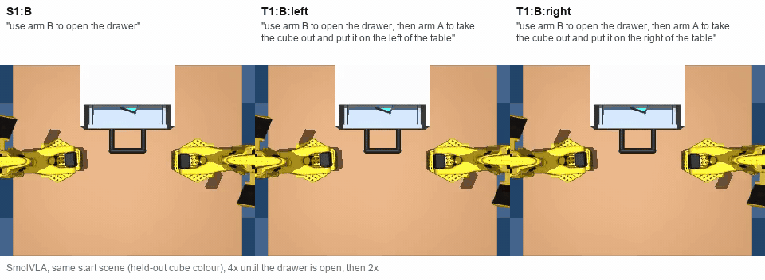

# Bimanual SO-101: does the command choose the arm?

A simulated two-arm SO-101 workcell (MuJoCo) where **the command is the only thing that tells the policy what to do**: which task, which arm, and where the cube goes.



*The same start scene, three commands: SmolVLA stops after opening the drawer, or hands over to arm A and puts the cube where it was told. Seed 100001, cube colour not seen in training.*

**What it does**
- The tasks are designed so that each can be done by either arm from the same start scenes, so nothing in the scene gives away the task, the arm or the target; a policy can only succeed by following the command.
- It tests whether a fine-tuned vision-language-action model (SmolVLA) takes the task, the arm and the target from the command, including when control passes from one arm to the other.
- It measures how well SmolVLA then does the task, against imitation policies (ACT, Diffusion Policy) that are told the task directly.
- Results so far cover one shared start scene and two of the six designed tasks (S1 and T1, below).

**Why this matters**
- A high success rate doesn't show that a policy read the instruction: if a scene only ever appears with one task, the policy can learn the scene and ignore the command.
- This happens in practice: [LIBERO-Plus](https://arxiv.org/abs/2510.13626) found vision-language-action models that scored almost the same with the instruction removed.
- Recent single-arm benchmarks ([InstructMove](https://arxiv.org/abs/2608.22990), [LangSwitch](https://arxiv.org/abs/2608.14822)) fix this by sharing scenes across tasks, so only the text picks the goal.
- With two arms the command can also name which arm acts, but in existing bimanual setups the scene usually gives that away: in [BiDex-100](https://arxiv.org/abs/2610.25459) the named arm is on its object's side, and in ALOHA and RoboTwin the task or the object's side decides the arm.
- Details and references: [docs/0background.md](docs/0background.md).

**Main results so far** (SmolVLA, simulation, 50 rollouts per variant)
- **It depends on the command.** From identical scenes it does the commanded task in 298 of 300 rollouts (stop, or hand over to the named arm); with an empty command it fails 20 of 20.
- **It only follows wording close to its training.** Under a held-out sentence shape the second arm never takes over (0 of 200).
- **It does the task worse than ACT told the task directly**, mainly placing the cube: 111 of 200 against 195 of 200.

## Tasks

Six tasks, each doable by either arm from the same start scenes (20 command variants in all). Arm A is the left arm, arm B the right.

| | Task | Example command | |
|---|---|---|---|
| S1 | Open drawer | "open the drawer with arm A" | evaluated |
| S2 | Close drawer | "close the drawer with arm B" | on hold |
| S3 | Cube into drawer | "put the cube in the drawer with arm A" | on hold |
| S4 | Cube out of drawer | "take the cube out of the drawer and put it on the left of the table with arm B" | on hold |
| T1 | Open, then take out (two arms) | "open the drawer with arm A, then take the cube out and put it on the right of the table with arm B" | evaluated |
| T2 | Put in, then close (two arms) | "put the cube in the drawer with arm B, then close the drawer with arm A" | on hold |

The tasks on hold are designed and scripted, but not yet recorded or trained on. Variants are written task:arm(:target): S1:A is S1 with arm A; T1:A:left is T1 with arm A opening and the cube put on the left.

## Results (draft: Diffusion Policy's evaluation is running)

**Setup.** One start scene (drawer closed, cube inside) shared by S1 and T1. Six variants: S1:A, S1:B, and T1 with either arm opening and the cube to the left or right. 300 scripted demonstrations (50 per variant), one training run per policy, 50 rollouts per variant on starts not used in training.

**Policies.**
- **SmolVLA** (the subject): fine-tuned on the 300 demonstrations with their text commands, two phrasings per task.
- **ACT and Diffusion Policy** (references): trained on the same demonstrations, but told the variant directly as a one-hot code, the way Meta-World MT10/MT50 gives multi-task policies a task ID. They show how well the task can be done from this data when the task is known; they never see words, so they can't be tested on language. Diffusion Policy is trained; its results will be added when its evaluation finishes.

Every count with its failed checks: [docs/3train_evaluation.md](docs/3train_evaluation.md).

### 1. Is SmolVLA's behaviour decided by the command or by the scene?

**Test.** S1 and T1 start from identical scenes (the same seeds), and T1's first step is S1, so once the drawer is open the two look the same. Only the command says whether to stop (S1) or hand over and take the cube out (T1), which arm acts, and which side the cube goes to. Control: the same starts with an empty command.

**Result.** It does the commanded task in 298 of 300 rollouts: no S1 rollout took the cube out, and 198 of 200 T1 rollouts handed over. With an empty command it fails all 20 the same way: arm B moves, arm A doesn't, the drawer stays shut.

**Conclusion.** Its behaviour depends on the text: from the same scene it does S1 or T1 as commanded, and without a command it does neither.

### 2. Does it still follow a command worded differently?

**Test.** The same starts, with wordings not seen in training: one held-out sentence shape per task ("arm A, pull the drawer open"), all 6 variants × 50; and eight more phrasings per task, S1:A and T1:A:left × 20.

| Wording | S1 done (drawer opened, arms held still) | T1 handed over to the second arm | T1 success |
|---|---|---|---|
| Training phrasings | 97/100 | 198/200 | 111/200 |
| Held-out sentence shape | 47/100 | **0/200** | 0/200 |
| Eight more phrasings | 10/20 | 8/20 | 0/20 |

**Result.** Phrasings close to the training ones work ("with arm A, open the drawer" 6/6); other structures fail ("can you open the drawer using arm A?" 0/3). This is the opposite of what LIBERO-PRO and LIBERO-Plus found on LIBERO, where VLAs kept succeeding with reworded, empty or nonsense instructions because each scene points to its task. Here the scene can't tell the task, so the text can't be ignored, and changing its wording breaks the policy.

**Conclusion.** No: it follows its training wording and phrasings close to it. Whether that comes from the VLA or from training on two phrasings per task is not tested yet (Q5).

### 3. How well does it do the task, against a policy told the task?

**Test.** The same starts for both policies. S1 is scored with and without its 5 mm limit on how far the cube may slide in the drawer (the expert's largest slide is 4.0 mm).

| | ACT | SmolVLA |
|---|---|---|
| S1 task: drawer opened, arms held still | 100/100 | 97/100 |
| S1 success: also cube slid < 5 mm | 72/100 | 76/100 |
| T1 success: cube within 2 cm of the named spot | 195/200 | 111/200 |
| Held-out cube colours, S1 / T1 success | 77 / 194 | 71 / 122 |

**Result.** S1: ACT does the task every time but slides the cube 4.2–4.9 mm (median), so its success rate moves with the limit (94–98% at 6 mm). SmolVLA pulls more gently but misses the task in 3 of 100. T1: every SmolVLA failure is the cube away from its spot, not the wrong arm or step. Unseen cube colours make no difference to either.

**Conclusion.** SmolVLA does the task worse than ACT, mainly the T1 placement. Not tested yet: whether that is the model or how it is run (it executes 50 actions before looking again, where ACT re-plans every frame; re-planning took ACT from 4/10 to 10/10 on S1).

### 4. How does each policy hold up when the scene goes past its training range?

**Test.** One scene factor at a time pushed past its training range, on S1:A and T1:A:left, 20 rollouts each, against the same 20 starts unchanged. This compares the policies as wholes, as RoboTwin 2.0, LIBERO-Plus and the SmolVLA paper do: SmolVLA and ACT differ in architecture, input, size, pretraining and how they are run, so a difference can't be put down to any one of these.

| Change | ACT S1:A task | SmolVLA S1:A task | ACT T1:A:left success | SmolVLA T1:A:left success |
|---|---|---|---|---|
| None (same 20 starts) | 20/20 | 20/20 | 19/20 | 12/20 |
| All three distractors (training: 0–2) | 20/20 | 19/20 | 19/20 | 14/20 |
| Cube turned up to ±40° (training: ±20°) | 20/20 | 19/20 | 18/20 | 9/20 |

A wider arm start pose was also run, but the idle-arm check misreads it (both policies move the idle arm back towards its usual pose, which the check counts as moving it; [finding 11](docs/3train_evaluation.md#findings-and-bugs)). It will be reported after a rerun with a corrected check.

**Result.** S1: neither distractors nor the turned cube affect either policy. T1: ACT stays at 18–19/20; SmolVLA moves between 9 and 14/20 from its 12/20 unchanged. Both still hand over to the named arm under each change.

**Conclusion.** On S1 both policies hold up to these changes. On T1 the comparison can't be read yet: SmolVLA already places the cube loosely without any change (Q3), and with 20 rollouts per cell differences of 3–4 are within noise.

### 5. Is the wording failure specific to the VLA? (planned)

Q2's wording failure could come from the VLA, or simply from training on two phrasings per task, which any policy reading text would suffer from. ACT and Diffusion Policy can't tell these apart, because they get a code, not words. The planned test gives them the same commands through a frozen DistilBERT sentence embedding, as OpenVLA's Diffusion Policy baseline on LIBERO does, and evaluates them on the same wordings as SmolVLA. Design: [docs/3train_evaluation.md](docs/3train_evaluation.md#planned-act-and-dp-reading-the-text-commands-readme-q5-not-run).

**Limits.** Simulation only; one scene and two of the six designed tasks; one training run per policy; 20–50 rollouts per cell.

## How this project developed

This project started as multi-task policy training: scripted bimanual demonstrations of six tasks, one imitation policy (ACT, Diffusion Policy) for all of them, then a fine-tuned vision-language-action model on the same tasks with varied commands.

While designing the tasks, it became clear how easily a scene gives the task away. If each task has its own start scene, a policy can succeed by recognising the scene and never reading the command, and the success rate can't tell the difference. Published work runs into the same problem on LIBERO: LIBERO-Plus found a VLA that kept its success with the instruction removed, and LIBERO-PRO found one that produced the same actions for a nonsense instruction. Making sure the scene couldn't give the task (or the arm) away became the centre of the project, and the question changed from "how well can policies do these tasks" to "does the command, not the scene, decide what the policy does".

Not every part of the design kept up with that change, and some mistakes were found late:

- **The baselines were chosen for the first question, not the second.** ACT and Diffusion Policy were given the task as a one-hot code so that one policy could cover every task (as Meta-World gives multi-task policies a task ID). The plan later used them to measure "the cost of reading language", which a policy that never reads words can't measure. They are now reported as references for doing the task, and the comparison that would answer the language question is planned (Q5).
- **Some measures measured a threshold or a check rather than the behaviour.** S1's success rate is mostly set by a 5 mm limit on how far the cube may slide (finding 9), and a wider arm start pose trips the idle-arm check when a policy only moves the arm back home (finding 11). Both are now reported apart from the behaviour.
- **The scope was cut** to one shared scene (S1 and T1) to reach the VLA sooner; S2–S4 and T2 are designed and scripted but on hold.

What held up is the core design: S1 and T1 start from identical scenes, so when SmolVLA stops or hands over, that choice can only have come from the command.

## Status

- **Built and validated:** the workcell, a scripted expert for all six tasks (800/800 successful on random starts), randomisation, the recorder, data checks, and policy evaluation in sim.
- **Now:** Diffusion Policy's evaluation (trained 100k steps on a rented RTX 4090; evaluated with 10 DDIM steps, checked against the 100 DDPM steps), then the start-pose rerun. Live state: [docs/STATUS.md](docs/STATUS.md).
- **Next:** stress factors that need small code changes (cube start shifted, camera pose, a mid-episode disturbance). Residual RL is parked as an optional step 6, for a gap the stress tests find.

## Quick start

Use the project's `.venv` Python.

```
python -m pytest tests -m "not slow"                                  # fast checks, ~40 s
python -m sim.validate 40                                             # scripted expert on random starts
python -m sim.record data/s1a --variants S1:A --per-variant 50        # record demonstrations (LeRobot dataset)
python -m sim.check_data data/s1a                                     # check a recording
python -m sim.dataset_view data/min data/min_onehot --variant-input   # add the one-hot command input for ACT
python -m sim.evaluate CKPT --variants S1:A --temporal-ensemble 0.01  # evaluate a trained policy in sim
```

Training uses LeRobot 0.6.1 (`lerobot-train`); the runs behind the results are in `scripts/`. `cloud/train.sh` runs ACT, SmolVLA or DP on a rented GPU: [docs/4cloud_training.md](docs/4cloud_training.md).

## Documents

| File | Contents |
|---|---|
| [docs/STATUS.md](docs/STATUS.md) | What is running now, what's next, open questions |
| [docs/0background.md](docs/0background.md) | Motivation, related work, the research question, what is evaluated, scope |
| [docs/1tasks_scene.md](docs/1tasks_scene.md) | Tasks, scene, randomisation, the scripted expert, success checks, files, and the step-by-step plan |
| [docs/2data_collection.md](docs/2data_collection.md) | Recording design, data checks, cube colours |
| [docs/3train_evaluation.md](docs/3train_evaluation.md) | Training and evaluation results, bugs and findings |
| [docs/4cloud_training.md](docs/4cloud_training.md) | Step by step: training on a rented GPU, evaluating on the Mac |
